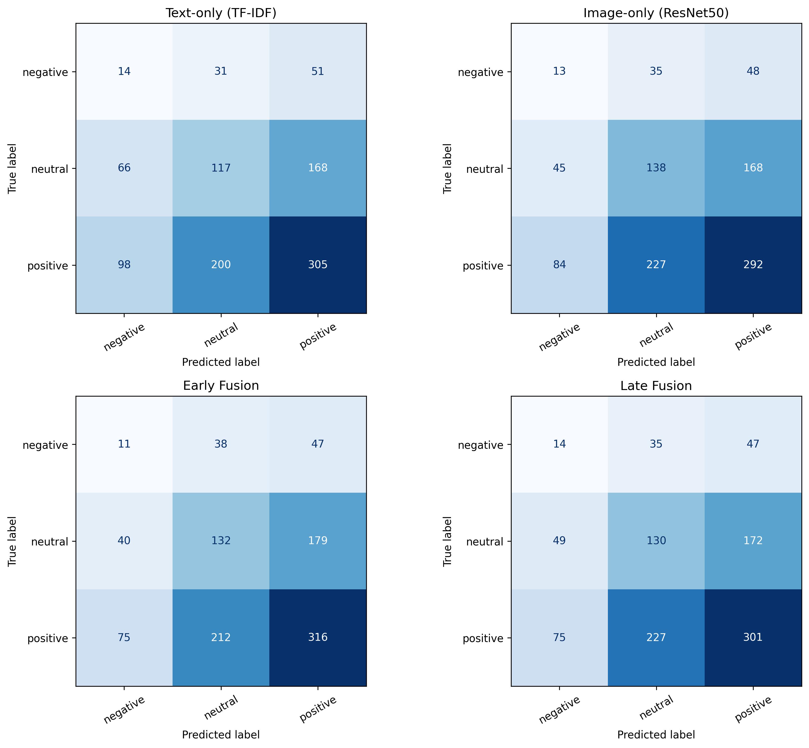
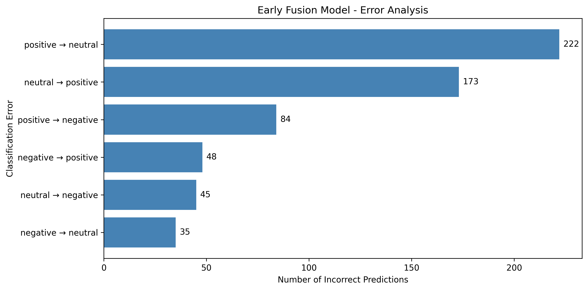

# memotion-multimodal-sentiment-analysis
Multimodal meme sentiment classification using text, images, early fusion and late fusion.
# Multimodal Meme Sentiment Analysis

## Project Overview
This project investigates sentiment classification of memes using both text and image information from the Memotion dataset. Four approaches are evaluated: text-only, image-only, early fusion and late fusion.

## Dataset
The Memotion dataset contains memes labelled as Positive, Neutral or Negative. The experimental split contains 4,894 training samples, 1,048 validation samples and 1,050 test samples.

## Methodology
- **Text-only:** TF-IDF features with a machine-learning classifier.
- **Image-only:** ResNet50 image features (2,048 dimensions) with a classifier.
- **Early fusion:** Concatenation of text and image features before classification.
- **Late fusion:** Weighted combination of text and image model predictions.

Hyperparameters and fusion weights were selected using validation data. Final evaluation was performed on the held-out test set.

## Test Results

| Model | Accuracy | Macro F1 |
|---|---:|---:|
| Text-only | 0.4152 | 0.3261 |
| Image-only | 0.4238 | 0.3351 |
| Early fusion | 0.4219 | 0.3327 |
| Late fusion | 0.4219 | 0.3318 |

  
The image-only model achieved the highest test accuracy (0.4238) and macro F1 (0.3351). Early and late fusion performed similarly, but neither outperformed the image-only baseline. The differences between models were small.

## Evaluation and Error Analysis
The project includes confusion matrices, error analysis and examples of misclassified memes. Negative sentiment is particularly challenging because of class imbalance and ambiguity in meme content.

.png)

## Repository Files
- `Copy_of_Memotion_Multimodal_Project (2).ipynb` — Experiment notebook.
- `test_results.csv` — Model evaluation results.
- `confusion_matrices.png` — Confusion matrices.
- `error_analysis.png` — Common classification errors.
- `misclassified_memes.png` — Examples of incorrectly classified memes.

## Limitations
- The sentiment classes are imbalanced.
- Memes may contain sarcasm, humour and conflicting visual/textual cues.
- The observed improvement from early fusion is small.
- Further work could investigate improved text representations, stronger image encoders and class-imbalance handling.

## Tools
Python, Google Colab, scikit-learn, PyTorch, torchvision, pandas and NumPy.

## Conclusion
Early fusion performed best among the four tested approaches, although all models showed limitations, particularly for minority-class sentiment prediction.
